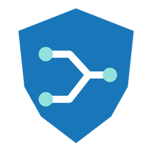

# OpenWrt VPN Controller для Home Assistant



Экспериментальная custom integration **0.2.0** для Home Assistant. Config/Options Flow, русский и английский интерфейс, пять платформ, независимые политики Manual/Auto для секций Podkop, метрики, диагностика и история.

**Добавлен экспериментальный нативный контроллер Podkop 0.7.23.** Он выполняет изменения UCI и вызывает штатный генератор Podkop; встроенная демонстрация также сохранена. Нативное применение и HTTPS-путь проверяются в изолированном OpenWrt 25.12.5 с sing-box 1.12.17. Управление на рабочем роутере по умолчанию выключено. Ограничения IPv6 и конкурентной записи LuCI описаны в [инструкции контроллера](docs/podkop-controller.ru.md).

Релиз **0.2.0** содержит архив интеграции HA, отдельный пакет контроллера OpenWrt, инструкцию и результаты проверок. Репозиторий временно приватный; скачивание релиза доступно владельцу после входа в GitHub.

## Установка 0.2.0 из релиза

Пока репозиторий приватный, устанавливайте интеграцию из ZIP. [HACS поддерживает только публичные репозитории](https://www.hacs.dev/docs/faq/private_repositories/).

1. Войдите в GitHub под учётной записью с доступом к репозиторию и откройте [релиз 0.2.0](https://github.com/kostenkodm/hass_openwrt_control/releases/tag/v0.2.0).
2. Скачайте **openwrt-vpn-ha-0.2.0.zip**. Скопируйте из него каталог `custom_components/openwrt_vpn` в `/config/custom_components/openwrt_vpn` вашего HAOS. При обновлении замените содержимое этого каталога, сохранив резервную копию прежней версии.
3. Перезапустите Home Assistant.
4. «Настройки» → «Устройства и службы» → «Добавить интеграцию» → **OpenWrt VPN Controller (prototype)**.
5. Для знакомства с интерфейсом выберите **«Демонстрационный режим»**. Для реальных секций сначала установите отдельный контроллер OpenWrt по [инструкции](docs/podkop-controller.ru.md), затем выберите **«Подключение к контроллеру»**.

Токен вашего HA и отдельный сервер для Demo не нужны. Минимальная заявленная версия Core — **2026.10.1**; проверка выполнялась с этой версией, установка в HAOS пользователя ещё не проверялась.

После восстановления публичной видимости можно будет добавить `https://github.com/kostenkodm/hass_openwrt_control` в пользовательские репозитории HACS, тип **Integration**, скачать компонент и перезапустить HA. [Порядок добавления репозитория](https://www.hacs.dev/docs/faq/custom_repositories/).

## Что смотреть после установки

Откройте устройство **OpenWrt VPN — Demo** в добавленной интеграции. Появятся 55 сущности: три секции `main`, `media`, `custom`, три VPN `vpn_a`, `vpn_b`, `vpn_c`, общие настройки и диагностика. Названия демонстрационных секций не означают, что такие секции найдены на целевом роутере.

1. У секции **main** выберите **vpn_b** в сущности политики. В начальном режиме `observe` предлагаемый VPN станет vpn_b, применённый останется vpn_a. Политики `media` и `custom` сохранятся.
2. В параметрах интеграции → «Общие параметры» выберите **control**. Теперь назначения применяются внутри симулятора.
3. Для автоматического выбора установите **main → Auto** и включите сущность **«Автоматический выбор VPN»**.
4. Параметры интеграции → **«Демонстрационные сценарии»** → **«vpn_a недоступен»**. main перейдёт на vpn_b после подтверждённых синтетических отказов. Ручные политики остальных секций сохранятся.
5. **«Все VPN недоступны»** сохраняет последнее назначение и включает тревогу. **«Восстановить все VPN»** возвращает доступность; обратное переключение учитывает время удержания, по умолчанию 600 секунд.
6. В версии 0.2.0 для каждого VPN есть кнопка **«Перезапустить …»**; в Demo она создаёт синтетическое событие. На OpenWrt перезапуск требует локального разрешения и проверки контроллера.
7. Посмотрите **«Недавние события»** и его атрибуты. Сценарий ошибки проверки позволяет проверить откат следующего применения.

Сущности можно добавить на свою панель штатными карточками HA. [Подробная инструкция](docs/prototype.ru.md) содержит пример проверки отката и описание хранения.

Демонстрация запускается внутри HA, слушает только loopback и останавливается вместе с HA. Её политики сохраняются после перезагрузки интеграции. Это режим знакомства с интерфейсом; нативный контроллер работает отдельной службой procd независимо от HA.

## Архитектура рабочего подключения

Home Assistant → **HTTPS ubus JSON-RPC с проверкой сервера** → автономный OpenWrt VPN Controller → UCI/Podkop.

Форма подключения подготовлена для ограниченного объекта `vpn.controller`. Интеграция разрешает команды встроенной демонстрации и нативному контроллеру `openwrt_ucode` с возможностью `policy_control`. Нативный режим `observe` сохраняет желаемые политики без переключения; `control` требует локального включения и проверок контроллера. Обычный ubus OpenWrt без специализированного контроллера этому протоколу не соответствует.

Отдельный RPC login и минимальный ACL; универсальные UCI, shell, управление службами и перезапуск сети Home Assistant не предоставляются. Защищённые интерфейсы определяются локальным списком на роутере и исключены из исходящих кандидатов. SSH предназначен для установки и резервной диагностики.

Исследованный reload Podkop 0.7.23 снимает перехват и перезапускает sing-box. Нативный адаптер сохраняет существующий перехват, формирует конфигурацию штатными функциями и обновляет только sing-box. Production-приёмка ещё требует проверки на ARM64 целевом роутере, полного покрытия IPv6 и решения остаточной гонки libuci с несогласованным конкурентным писателем.

## Для разработки

В WSL/Linux из корня проекта:

```sh
bash tools/bootstrap.sh
bash tools/run_tests.sh
work/venv-linux/bin/python -m tools.demo
work/venv-linux/bin/python -m tools.package_prototype
```

Все необходимые для HACS файлы находятся в `custom_components/openwrt_vpn/`, включая демонстрационный backend. Корневые `simulator/` и `tools/` нужны только для разработки и отдельного лабораторного сервера. Отчёты и архивы 0.2.0: `outputs/podkop-0.2.0/`; зависимости и приватные файлы стенда: `work/`, исключены из Git.

## Материалы

- [Проверки прототипа 0.2.0](docs/podkop-0.2.0-validation.ru.md)
- [Результаты проверки](docs/prototype-validation.ru.md)
- [Протокол прототипа](docs/protocol-prototype.ru.md)
- [Архитектура](docs/architecture.ru.md)
- [Сравнение SSH/ubus и анализ FUjr](docs/transport-ubus-addendum.md)
- [Аудит трёх референсов](docs/reference-audit.ru.md)
- [Проверка Podkop 0.7.23](docs/podkop-0.7.23-audit.ru.md)
- [Статус OpenWrt-адаптера](openwrt/README.md)

Репозиторий временно приватный. Публикация версии 0.2.0 согласована владельцем. К целевому роутеру и действующему HA подключений не было; разрешение на production-внедрение не предоставлено.

Лицензия: [MIT](LICENSE), выбранная владельцем проекта.
